# KrissOS Shell: UI/UX polish audit (Wave 6 input)

Audited 2026-11-19 on the live dev shell on the CachyOS PC (two 2560×1440 screens, 180 Hz).
The dev copy is the #75 stack (`kz/shell-mac-layout`) plus the acrylic branch and the #84 Inter
font edits, so it is close to the final Wave 0–5 look. Each PR so far was checked only against its
own "Done when". This audit looks at the whole design together. It fixes nothing.

**How it was checked.** Every surface was opened over IPC and captured with `grim` in 8 states:
Windows and Mac layouts × light and dark × text at 100% and 150%. That is 144 screenshots, plus a
frame burst of Start opening and closing, and the lock screen at 100% and 150%. The QML was read
against `docs/shell-roadmap.md`, `theme/tokens.json` and `Theme.qml` (radii, type sizes, weights,
spacing, durations and curves), and contrast was computed with `theme.js`'s own `contrast()`.
`shell.json`, the text size and the colour scheme were put back exactly as they were (same
sha256).

**Line numbers** point at the dev copy (`~/.local/share/kriss-shell-dev/qml`), so they can be a
few lines off after the Wave 5 merges. Each item quotes the code so it can be found by search.

**Not covered.** Widgets: `Widgets.qml` is in the tree but nothing in `shell.qml` creates it, so
Win+W does nothing on this build (#72 wires it). Snap layouts: Win+Z does nothing here (item 15).
The tray overflow flyout: no icons are hidden on this PC, so there is no ^ button. The
Alt+Tab switcher was left out because stepping it would change focus in the user's session.
High contrast was spot-read in code only.

## Ranking

Score = severity (1 cosmetic, 2 looks unfinished, 3 broken or fails a rule) × how often a user
sees it (1 rarely, 2 per session, 3 all the time).

| # | Problem | Sev | Freq | Score | PR |
|---|---|---|---|---|---|
| 1 | Clock digits sit in fixed "0"-wide slots: "1 5:30" has a hole | 2 | 3 | 6 | A |
| 2 | Focus rim shows on open even with the pointer; emoji picker shows two rims | 2 | 3 | 6 | B |
| 3 | Bell badge counts the whole history, so it never clears | 2 | 3 | 6 | D |
| 4 | Light mode: warm accents go muddy, and accent text fails 4.5:1 | 3 | 2 | 6 | C |
| 5 | A toast lands on top of open quick settings | 3 | 2 | 6 | D |
| 6 | Fixed-width panels at 125%+ text: Start, calendar, notification center, Personalise clip | 3 | 2 | 6 | E |
| 7 | Lock screen, greeter and snap labels ignore the text size | 3 | 2 | 6 | E |
| 8 | Light mode: white tray icons vanish on the light bar | 2 | 3 | 6 | C |
| 9 | Notification center is a loose stack: oldest on top, group not shown, calendar adrift | 2 | 2 | 4 | D |
| 10 | Start's Recommended shows junk and look-alike files, all with one icon | 2 | 2 | 4 | F |
| 11 | The Performance pill is the loudest thing in the bar | 1 | 3 | 3 | A |
| 12 | Quick settings: the theme tile renames itself; few tiles; 28 px targets | 2 | 2 | 4 | B |
| 13 | No radius or spacing scale: 19 radius values, spacing off any grid | 1 | 3 | 3 | A |
| 14 | COSMIC apps and window titles stay dark when the shell goes light | 2 | 1 | 2 | C |
| 15 | Win+Z (snap layouts) silently does nothing | 2 | 1 | 2 | G |
| 16 | Jump list: two rows both called "krissos", no folder or icon | 1 | 2 | 2 | F |
| 17 | Mac layout: tiny dock, Windows Start floated over it, sheet handle at the bottom | 2 | 1 | 2 | G |
| 18 | Slider tracks and outside-month days are below 3:1 | 1 | 2 | 2 | C |
| 19 | Panels leave the way they arrive: same length and curve out as in | 1 | 2 | 2 | A |
| 20 | Personalise: title shown twice; fixed window; nav label overflows | 1 | 1 | 1 | E |
| 21 | Start and lock show the login name ("idiazraz"), not the person's name | 1 | 2 | 2 | F |

## Items

### 1. Clock digits leave a hole after a "1"
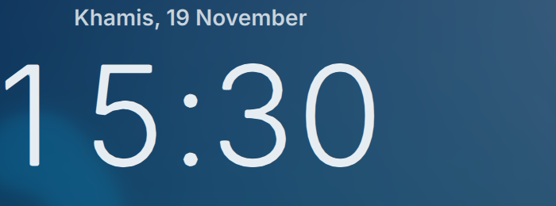
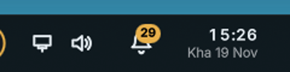

`RollingText` gives every digit a slot as wide as "0" and draws the digit at the slot's left. Inter's
"1" is narrow, so "15:30" reads as "1 5:30" on the taskbar clock, the top bar and the lock screen's
large clock, where the hole is about 40 px. This is the most-seen glitch in the shell.

- File: `shell/qml/RollingText.qml:28`, `width: digit ? Math.ceil(zero.implicitWidth) : plain.implicitWidth`
- Fix: size each slot to its own digit (a hidden `Text` per slot, with `Behavior on width` so it eases
  when the digit changes), or turn on Inter's tabular figures (`font.features: { "tnum": 1 }`, Qt 6.7+)
  so every digit is drawn the same width, and centre each column in its slot. Check the lock clock,
  the taskbar clock, the battery and the volume.

### 2. The focus rim shows when nothing was keyed
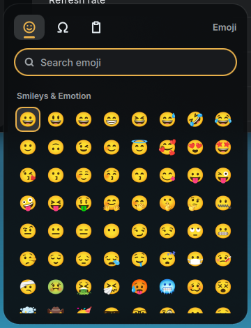
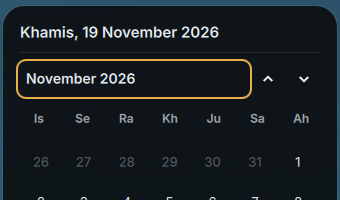

Opening a panel moves keyboard focus into it, and `FocusRim` shows whenever its item has active
focus. So every open shows an accent outline on something: the "November 2026" title in the calendar
(it looks like a text box), the Do not disturb tile in quick settings (it looks selected), the newest
notification card, the first Start entry and the first row of each menu. The emoji picker draws two
rims at once: the search field and the first emoji. Windows and macOS show focus only once a key moves
it.

- Files: `shell/qml/FocusRim.qml:14` (`visible: target.activeFocus`); `shell/qml/Clipboard.qml:531`
  (`border.width: cellBtn.on && search.activeFocus ? Theme.focusWidth : 0`)
- Fix: add `Desktop.keyNav`, set true on Tab, the arrows or Enter, and false on any pointer press or when a
  panel opens. Make the rim `visible: target.activeFocus && Desktop.keyNav`. In the emoji grid, mark the
  current cell with the hover fill (`Theme.cardHover`) instead of a second accent border. Orca still
  reads focus, since only the drawing changes.

### 3. The bell badge counts every stored notification
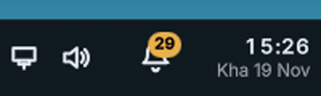

The badge shows `Notifs.all.length`: everything in history, up to 100. On this PC it read 20 at the
start and 30 by the end. It only drops with Clear all, so it stops meaning "something new". It also
sits on the bell glyph and covers half of it.

- File: `shell/qml/Bar.qml:381` and `:388` (`visible: Notifs.all.length > 0`, `text: Notifs.all.length`)
- Fix: count notifications that arrived since the center was last opened (keep a `seenAt` time in
  `Notifs`, set when `notificationsOpen` becomes true), and hide the badge at 0. Move it to the top-right
  corner of the button, not over the glyph, and make it a dot when the count is over 9.

### 4. Light mode: warm accents go muddy, and accent text fails AA
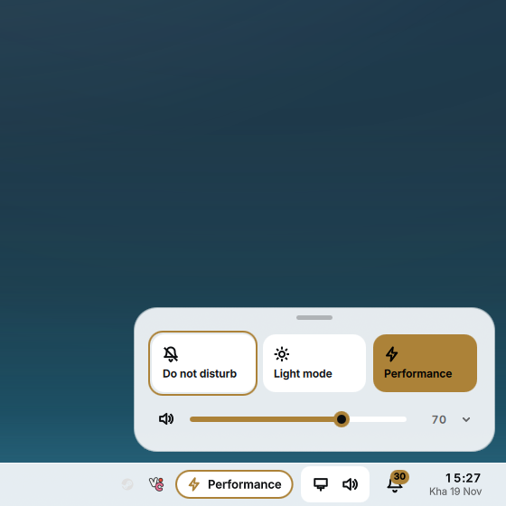
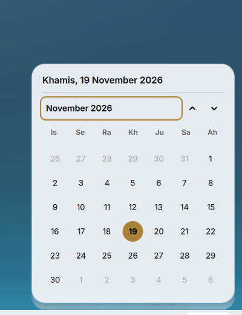

`T.shades()` darkens the accent until it reaches 3:1 on the light background, and then the same colour
fills tiles, chips, switches and today's date. Amber `#E8B04B` becomes `#AC8238`, a brown, and green
`#57C785` becomes `#449B68`. Fills don't need 3:1 against the page, because their ink is what has to read.
The darkened colour is also used as small text ("Clear 3" on notification cards, the "Emoji" label,
links). At about 3.1–3.5:1 that fails the 4.5:1 that 12–13 px text needs.

| Accent | Light fill now | Contrast vs page |
|---|---|---|
| Amber `#E8B04B` | `#AC8238` | 3.11 |
| Sky `#24B1E6` | `#1E95C1` | 3.05 |
| Green `#57C785` | `#449B68` | 3.04 |
| Coral `#F07A73` | `#D36B65` | 3.08 |

- Files: `shell/qml/theme.js:76-81` (`shades()`), `shell/qml/Theme.qml:37-42`, accent text at
  `Notifications.qml:426` ("Clear N")
- Fix: split the role. `Theme.accent` is the fill, kept at the picked colour in both modes with
  `accentInk` on it (black on amber is 10.7:1). Add `Theme.accentText`, darkened to 4.5:1 against the
  card it sits on, for text, links and thin rims, and use it wherever the accent colours text. Add both
  pairs to `shell/theme-check`.

### 5. A toast covers open quick settings
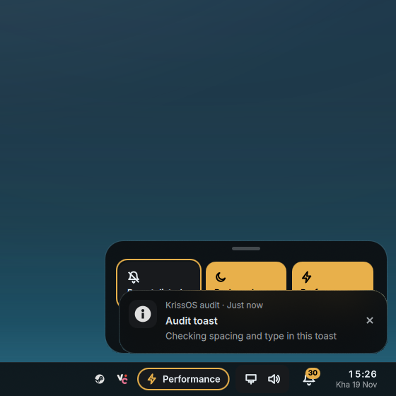

Toasts sit bottom-right on the overlay layer, and quick settings opens in the same corner. A notification
that arrives while quick settings is open lands on its tiles. The comment at `Notifications.qml:118`
says this is on purpose, but on screen it reads as a bug: the tiles are hidden and can't be clicked.

- File: `shell/qml/Notifications.qml:118` (toast stack placement)
- Fix: while `Desktop.quickOpen` (or the calendar) is open, lift the toast stack above the panel
  (`bottomMargin += quick panel height + Theme.panelGap`), animated with `Theme.normal`. Or hold toasts
  the way fullscreen does and show them when the panel closes.

### 6. Fixed widths don't grow with the text size
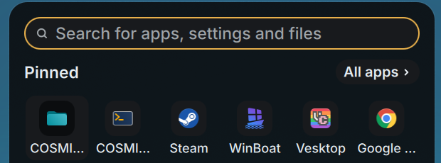
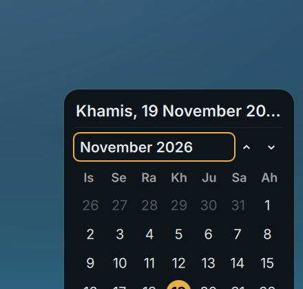
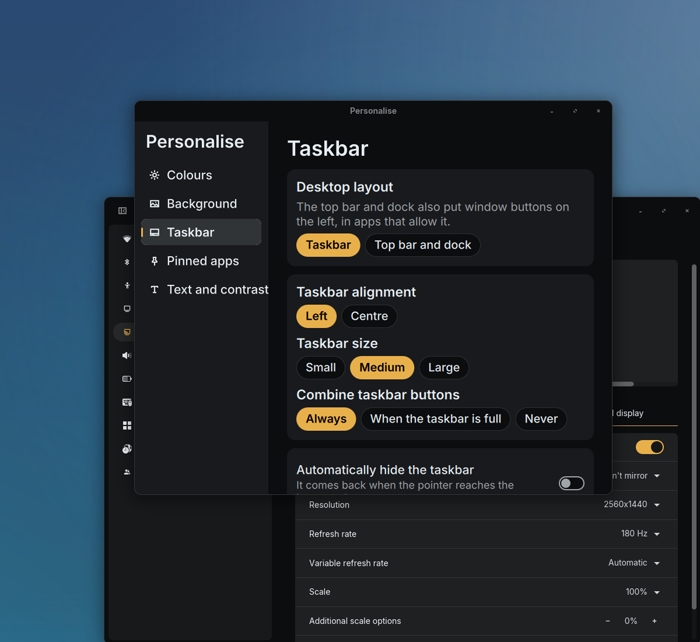

Text follows `Theme.sp()`, but the panels keep their pixel widths. At 150%, Start's pinned names cut to
"COSMI…" and "Google …", the calendar header cuts to "Khamis, 19 November 20…", notification bodies wrap
mid-file-name ("…104957.p / ng") and timestamps cut ("Today at 11:…"), and Personalise clips its settings
with the nav label "Text and contrast" running past the sidebar. The roadmap's a11y item says "text
follows the system scale". The text does, but the layout around it doesn't.

- Files: `Launcher.qml:275` (`width: 600`), `Calendar.qml:41` (`width: 336`),
  `Notifications.qml:64` (`implicitWidth: 380`), `Personalise.qml:18-20` (820×640, min 600×440) and
  `:66` (`width: 230` sidebar), `Clipboard.qml:307` (cells)
- Fix: add `Theme.dp(px)`, which returns `Math.round(px * Math.max(1, (1 + textScale) / 2))` like the bar already
  does, and use it for panel widths and the sidebar. Let Personalise's window grow its implicit size the
  same way. Pinned labels: allow two lines (`maximumLineCount: 2`) before eliding, as Windows does.

### 7. The lock screen, greeter and snap labels ignore the text size
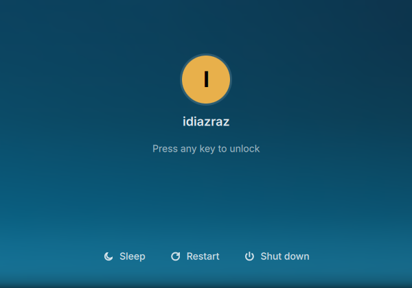

The lock screen at 150% is pixel-identical to 100%. "Press any key to unlock" stays at 12 px, mid-grey
on a mid-blue wallpaper, and the Sleep, Restart and Shut down labels stay at 13 px. These are the screens
a low-vision user meets first.

- Files: `LockFace.qml:135, 142, 207, 223, 273, 297, 324, 334` and `LockButton.qml:61`
  (`pixelSize: 14` etc., not `Theme.sp()`), `greeter.qml:182`, `Snap.qml:402`, `Clipboard.qml:717` (emoji 24)
- Fix: route them all through `Theme.sp()`. The greeter runs before login, so it should read the text
  size the same way (gsettings for the greeter user, default 1). Raise the hint to 14 px at
  `Theme.alpha(nightFg, 0.8)` so it reaches 4.5:1 on the brightest wallpaper time of day.

### 8. Light mode: white tray icons disappear
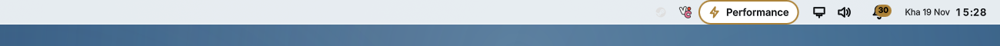
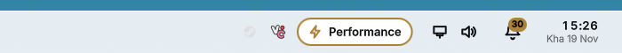

Apps hand the tray monochrome white icons (Steam here). On the light bar they're nearly invisible.
COSMIC's own tray and Windows both recolour monochrome tray icons to fit the theme.

- File: `shell/qml/TrayIcon.qml:102` (`IconImage { source: tray.modelData.icon }`)
- Fix: when `!Theme.dark`, look for a `-symbolic` version of the icon name first (Papirus has them for
  Steam, Discord and most others), and colourise it with `MultiEffect { colorization: 1; colorizationColor: Theme.fg }`.
  Otherwise, if the icon's mean luminance is above 0.85, draw it on a small `Theme.alpha(Theme.fg, 0.7)` disc.

### 9. The notification center is a loose stack
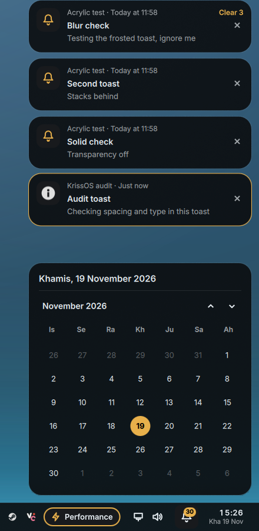

Three floating pieces (a header pill, a column of cards and a calendar card) with a gap of about 60 px
that changes with the list. The newest is at the bottom and the oldest scrolls off under the header with
a hard cut and no fade. The roadmap says "history grouped by app", but a group only shows as a "Clear 3"
link on its first card. Three "Screenshot saved" cards repeat in full. The Do not disturb and Clear all
buttons are 28 px tall.

- Files: `Notifications.qml:166-245` (header, 28 px controls), `:255-262` (scroller, `contentY: contentHeight - height`)
- Fix: one panel, newest on top, with an app header row per group (icon, app name, count, clear) and the
  group's cards stacked Sonner-style, expanding on click. A 24 px fade at the scroller's top edge. The
  calendar attached under the list in the same panel, with a hairline between. Header buttons at least
  32 px (Fitts, and Windows uses 32).

### 10. Start's Recommended shows junk and look-alikes
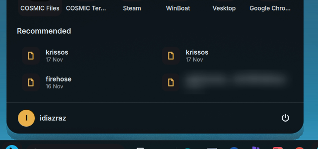

Recommended is the first four `file:` entries of `recently-used.xbel`, as they are. On this PC that's two
items both called "krissos" (a folder and a file?), "firehose", and a browser OAuth callback file whose
name holds an access token (blurred in the crop). That last one is a privacy problem on a screen people
share. Every row uses the same generic file glyph in accent, folders included.

- Files: `Desktop.qml:265` (reads `recently-used.xbel`), `Launcher.qml:243-244` (`recentAll.slice(0, 4)`),
  `:537` (`Glyph { name: "file" }`)
- Fix: drop entries that no longer exist, hidden paths, `~/.cache`, and names with `?`, `=` or no
  extension that look like tokens (length > 24 with no spaces). Use the mime icon
  (`Quickshell.iconPath(mimeIcon)`). When two names match, show the parent folder as the detail line
  ("krissos · Documents") instead of only the date.

### 11. The Performance pill outshouts the clock
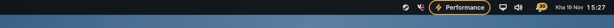

When the profile is Performance, the pill gets a 2 px accent rim, accent text and a label, which makes it
the brightest thing in both bars. Neither Windows nor macOS puts the power mode in the bar. That makes it
KrissOS's own idea, which is fine, but it should be quiet.

- File: `shell/qml/PowerPill.qml:50-60`
- Fix: icon only, in `Theme.fg`, with the label in its tooltip. Use the accent only for Power saver on battery
  (where it matters). Keep the click-to-cycle.

### 12. Quick settings: a self-renaming tile, few tiles, small targets

The theme tile is labelled "Dark mode" when on and "Light mode" when off. That breaks the toggle rule:
the label names the thing, and the fill shows the state. Off, it reads as "Light mode is off". The panel
has three tiles and a volume row on this desktop. With no Wi-Fi or Bluetooth here, the panel looks
unfinished, and Windows shows Night light, Accessibility, Cast and so on. The grabber handle is a phone
sheet affordance with no use on a desktop.

- Files: `QuickSettings.qml:318` (`label: Theme.dark ? Tr.t("Dark mode") : Tr.t("Light mode")`),
  `:187` (grabber)
- Fix: always "Dark mode", with the fill showing on or off. Add tiles that work on every PC: Night light
  (cosmic's colour temperature), Text size (opens Personalise > Text), Screenshot and Accessibility. Hide
  the grabber unless the panel can actually be dragged.

### 13. No radius or spacing scale
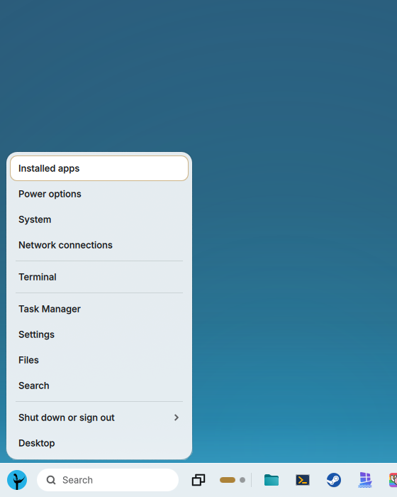

`Theme` has three radii (`radius` 22, `radiusSmall` 14, `barRadius` 10), but the QML uses 19 distinct
literal radii (2–25). Outer panels use 26 (Start, `Theme.radius + 4`), 22 (quick settings, calendar,
notifications, clipboard) and 14 (menus, previews, Task View cards, the tray flyout). Rows inside use 8
in some places and 10 in others. Spacing uses 0–30 in steps of 1 (3, 5, 7, 14, 18 and 22 all appear),
and only `gap` and `panelGap` are named. The eye reads this as "slightly off" more than any single bug.

- Files: `Theme.qml` geometry block, and every `radius: N` and `spacing: N` literal (69 radius literals;
  `grep -nE "radius:\s*[0-9]" shell/qml/*.qml`)
- Fix: name the scale in `Theme`: `rPanel 22`, `rCard 14`, `rControl 10`, `rChip` = height/2, and spacing
  on 4 (`s1 4 … s6 24`). Start goes to `rPanel`, menus and previews to `rCard`, and rows to `rControl`.
  Nested shapes follow outer radius minus padding. Add a check to `shell/theme-check` that fails on new
  literal radii.

### 14. COSMIC apps don't follow the shell into light mode live
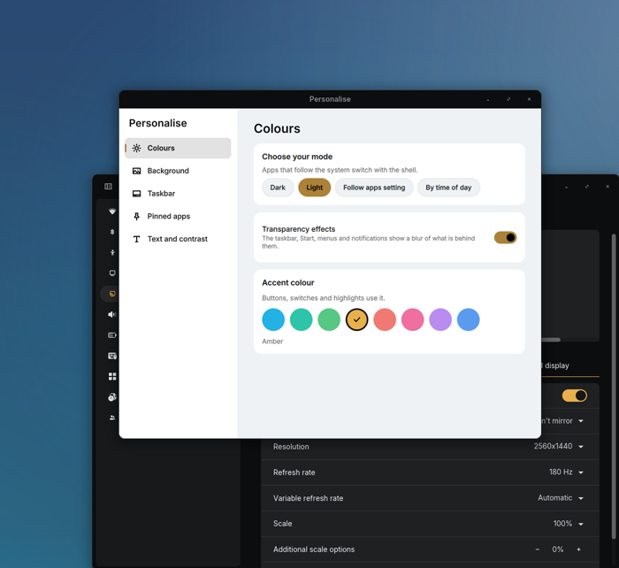

Two seconds after `theme set mode light`, the shell was light but COSMIC Settings and the server-side
title bar of Personalise were still dark. Verdict: plausible, not confirmed. It may only be a delay, or
the `is_dark` write may need cosmic-settings-daemon to pick it up.

- File: `Theme.qml` `syncMode()` (writes `com.system76.CosmicTheme.Mode/v1/is_dark`)
- Fix: check whether COSMIC watches that file live. If not, set it through `cosmic-settings` or the
  `cosmic-config` D-Bus path that the COSMIC panel uses.

### 15. Win+Z does nothing
`snap layouts` over IPC with a focused window shows no picker and no message. `layoutsForActive()`
returns early because `Windows.snapReady` is false (the helper never got a `snap` message from
`cosmic-comp-kriss 1.11.0-3`). To a user the key is just dead.

- File: `Snap.qml:55` (`if (!Windows.snapReady || !w || !geoOf(w)) return;`), `Windows.qml:147, 195`
- Fix: find out why `snap` isn't reported on this build (it may be a packaging gap). In the shell, when
  it isn't ready, show the picker's halves and quarters anyway using the existing keyboard snapping, or
  show a one-line toast. Never ignore the key silently.

### 16. Jump list: twin rows with no context
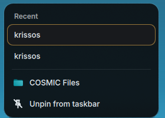

Files' jump list shows "krissos" twice: two different paths with the same name, with no icon and no
folder. The app rows below it have icons, so the list mixes two styles.

- File: `Bar.qml:562-590` (`Desktop.recentFor(e, 8)`)
- Fix: the same rules as item 10: a mime icon, and the parent folder in `Theme.soft` when names repeat.

### 17. Mac layout: tiny dock, Windows Start, sheet handle at the bottom

The dock is the 48 px taskbar with 24 px icons, centred. On a 1440p screen it reads as a toolbar, not a
dock. The Mac-layout Start is the Windows Start panel, centred over the dock. That's acceptable for
"familiar, not a clone", but the dock's Apps button and Spotlight habits (search in the top centre)
aren't there. Quick settings drops from the top bar but keeps its grabber at the bottom edge.

- Files: `Theme.qml` (`barIcon`, `dockGap`), `Launcher.qml:272` (centred x), `QuickSettings.qml:187`
- Fix: give the dock its own size (`dockIcon 40`, `dockHeight 60`) with Small, Medium and Large in
  Personalise. In the Mac layout, open Start in its search mode at the top centre (Spotlight position),
  and show the full grid from the dock's Apps button. Drop the grabber (item 12).

### 18. Low-contrast tracks and dimmed days
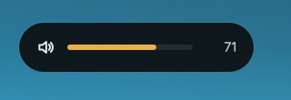

The unfilled part of the OSD and volume sliders is `Theme.line`, 1.24:1 against the bar. Non-text UI
needs 3:1 (WCAG 1.4.11). The calendar's days outside the month are `alpha(soft, 0.5)`: 2.75:1 dark and
2.19:1 light. They're clickable, so the inactive-text exemption doesn't apply.

- Files: `Osd.qml:117`, `QuickSettings.qml:659-663`, `Month.qml:156`
- Fix: track `Theme.alpha(Theme.fg, 0.28)` (about 3:1 on both bars), and outside days `alpha(soft, 0.7)`.

### 19. Panels leave the way they arrive
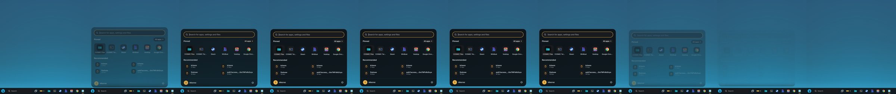

Motion is the most consistent part of the shell: 108 animations use `Theme.ease`, and everything goes
through `Theme.ms()`. The one gap is that closing reuses the opening length and the out-curve, so
dismissing Start, quick settings or a menu feels as slow as opening it. The burst shows Start fully
in by about 70 ms and fading out over about 110 ms with the same 12 px travel.

- Files: `Launcher.qml:282-290` (and the same pattern in each panel)
- Fix: add `Theme.exit` (`Easing.InCubic`) and close at `Theme.fast * 0.8`. Set the duration from the
  target state: `duration: Theme.ms(open ? Theme.normal : Theme.fast)`.

### 20. Personalise: the title twice, a fixed window
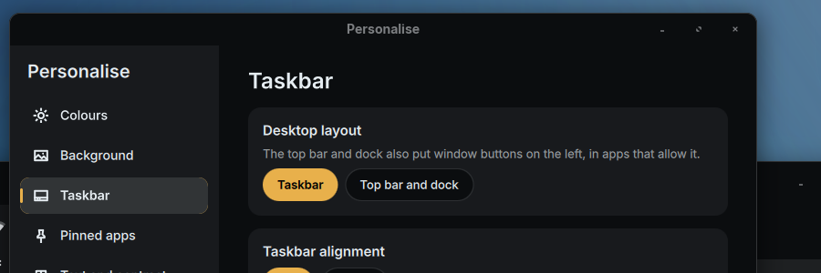

The window title bar says "Personalise", then the sidebar header says "Personalise" in 20 px, and then the
page title. That's three titles stacked. The window doesn't grow with the text size (item 6).

- Files: `Personalise.qml:77` (sidebar header), `:18-20`
- Fix: drop the sidebar header, or make it the search field Windows Settings has there.

### 21. The login name, not the person
Start's footer and the lock screen show `$USER` ("idiazraz") and its first letter as the avatar.
Windows and macOS show the full name and the account picture.

- Files: `Launcher.qml:586-599` (`Quickshell.env("USER")`), `LockFace.qml:200-205`, `Avatar.qml`
- Fix: read the name from GECOS (`getent passwd $USER | cut -d: -f5 | cut -d, -f1`) and the picture from
  AccountsService (`/var/lib/AccountsService/icons/$USER`), and fall back to `$USER`. `kriss-welcome`
  already asks for a name.

## Suggested Wave 6 PRs

Small, one branch each, in this order. A and C touch `Theme.qml`, so merge them first and rebase the
rest.

| PR | Branch | Items | Size | Done when |
|---|---|---|---|---|
| A | `kz/polish-tokens` | 1, 11, 13, 19 | M | The clock has no digit holes; `Theme` names the radius and spacing scale and every surface uses it; closing is faster than opening; the power pill is quiet; `theme-check` fails on new literal radii |
| B | `kz/polish-focus` | 2, 12 | S | No focus rim until a key moves focus; one rim at a time everywhere; the theme tile keeps its name; quick settings has Night light, Text size, Screenshot and Accessibility tiles |
| C | `kz/polish-light` | 4, 8, 14, 18 | M | Accent fills keep the picked colour; accent text passes 4.5:1 (in `theme-check`); tray icons read on the light bar; COSMIC apps flip with the shell; tracks reach 3:1 |
| D | `kz/polish-notifications` | 3, 5, 9 | M | The badge counts unseen notifications only; toasts never cover an open panel; the center is one panel, newest first, grouped by app, with 32 px buttons |
| E | `kz/polish-text-size` | 6, 7, 20 | M | At 150% and 200%, no shell surface clips or cuts a label; the lock screen and greeter scale; Personalise grows |
| F | `kz/polish-start-files` | 10, 16, 21 | S | Recommended and jump lists skip junk and token-like names, use mime icons, and tell same-named files apart; Start and lock show the full name |
| G | `kz/polish-mac-and-snap` | 15, 17 | M | Win+Z always answers; the dock has its own size; Mac-layout Start opens like Spotlight |

After each PR, re-run the same 8-state capture on the PC with
[`shell-polish-audit/capture.sh`](shell-polish-audit/capture.sh). It backs up `shell.json` and restores it afterwards.
